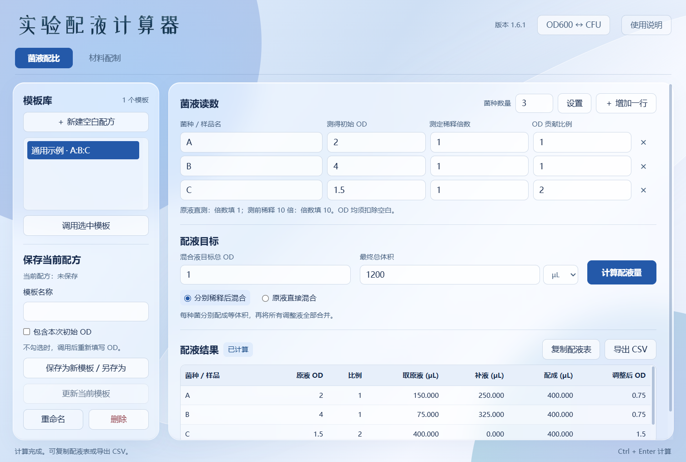
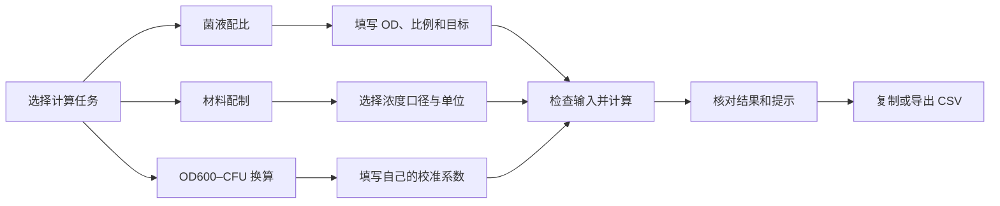
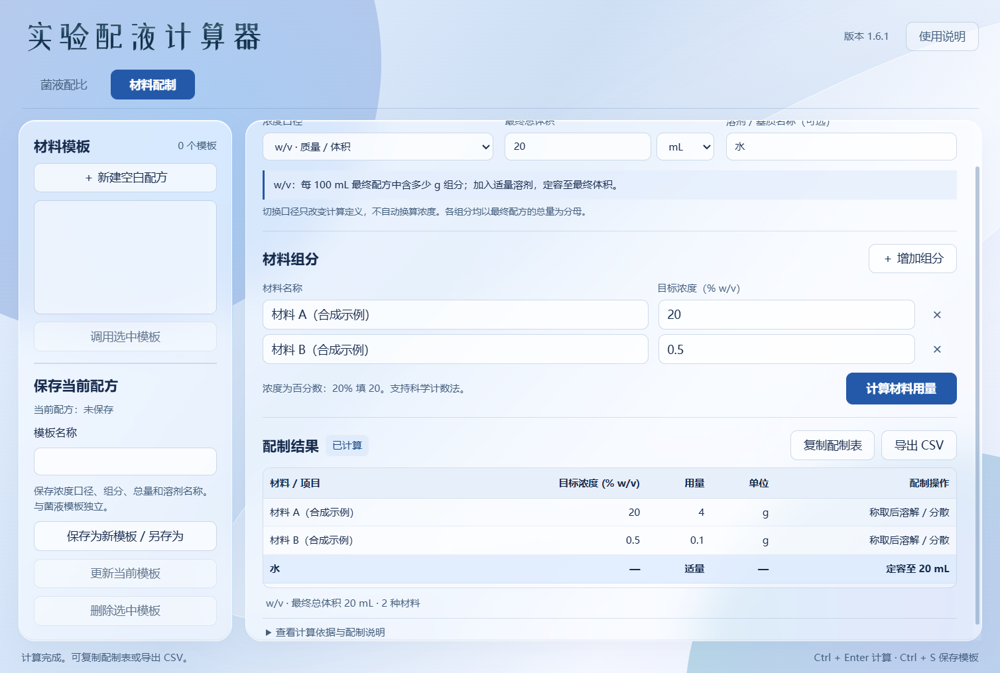
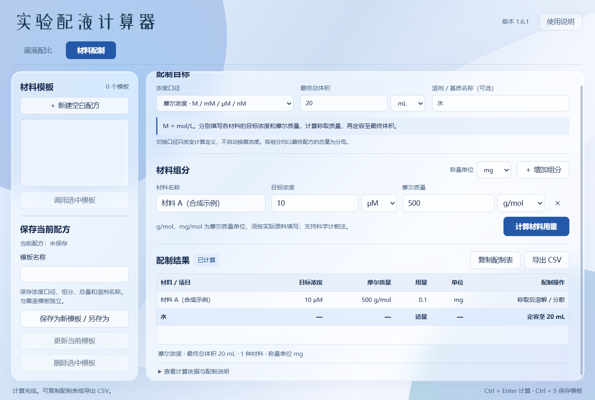
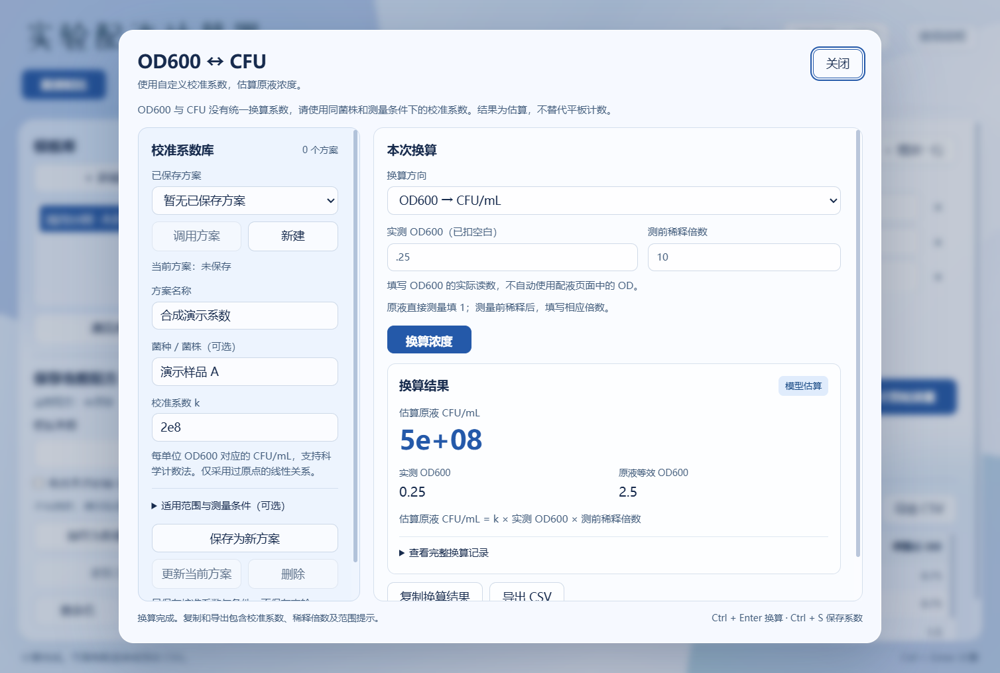

# 实验配液计算器

面向日常实验配液的中文 Windows 桌面工具：计算多菌液的 OD 贡献配比、材料的百分浓度与摩尔浓度配方，并按自定义校准系数进行 OD600–CFU 换算。

当前版本：**1.6.1**。计算、模板和结果导出均在本机完成。

[下载 Windows 发行版](../../releases/latest) · [完整使用指南](docs/guide.md) · [第三方来源与许可](THIRD_PARTY_NOTICES.md)



> 本页截图和计算示例均使用合成演示数据，不代表任何菌株、材料或实验的推荐条件。公开源码和发行包不包含个人模板、实验记录或校准数据。

## 可以做什么

| 功能 | 输入 | 输出 |
| --- | --- | --- |
| 菌液配比 | 各菌液 OD、测前稀释倍数、贡献比例、目标 OD 和总体积 | 各原液取液量、补液量及理论混合 OD |
| 百分浓度配制 | w/w、w/v 或 v/v、最终总量、各材料目标浓度 | 多组分材料用量及补足质量或定容说明 |
| 摩尔浓度配制 | M、mM、μM 或 nM、最终体积、每种材料的摩尔质量 | 可选择 g、mg、μg 的称量质量 |
| OD600 ↔ CFU | 自行提供的校准系数、读数、稀释倍数及适用范围 | 原液浓度估算、等效 OD 和范围提示 |
| 模板与导出 | 各模块的配方或校准方案 | 本地保存、重新调用、复制表格和 CSV |

菌液配比和材料配制是独立工作表，切换时保留各自本次输入和结果；OD600–CFU 换算从菌液页右上角打开。



## 下载与运行

1. 在 [Releases](../../releases/latest) 下载 Windows 发行压缩包并解压。
2. 双击 `实验配液计算器.exe`。
3. 选择计算模块，填写本次输入后计算。

发行版面向 Windows 10 / 11，需要系统已有 **Microsoft Edge WebView2 Runtime**，无需安装 Python。程序使用本地界面文件和矢量字标，不依赖在线字体。

如果界面提示缺少 WebView2，请先安装 Microsoft 官方提供的 WebView2 Runtime，再重新启动程序。未保存的本次输入不会在退出后自动恢复；需要复用时请保存为模板。

## 材料配制：先选清楚浓度口径



| 口径 | 含义 | 最终总量 | 溶剂如何处理 |
| --- | --- | --- | --- |
| w/w | 每 100 g 最终配方中的组分质量，g | mg、g 或 kg | 由质量守恒计算补足总质量所需的质量 |
| w/v | 每 100 mL 最终配方中的组分质量，g | µL、mL 或 L | 加入适量溶剂，最后定容至目标体积 |
| v/v | 每 100 mL 最终配方中的液体组分体积，mL | µL、mL 或 L | 混合后定容至目标体积 |

例如：20 g 的 20% w/w 配方需要材料 4 g、溶剂 16 g；20 mL 的 20% w/v 配方需要材料 4 g，再定容至 20 mL。两者的分母不同，不能仅凭数值相同视为同一配方。

固体溶解和液体混合后的体积不保证简单相加，因此 w/v、v/v 模式输出定容目标，不把“最终体积减去材料量”当成准确补液体积。切换浓度口径会使旧结果失效，须核对输入后重新计算。

## 摩尔浓度：将浓度与摩尔质量分开填写



| 输入类别 | 支持单位 |
| --- | --- |
| 目标摩尔浓度 | M、mM、μM、nM |
| 摩尔质量 | g/mol、mg/mol |
| 最终总体积 | µL、mL、L |
| 称量结果 | g、mg、μg |

`M = mol/L`；`g/mol` 和 `mg/mol` 是摩尔质量单位。每种材料可分别填写自己的浓度单位和摩尔质量，程序按最终体积计算：

`质量(g) = 浓度(mol/L) × 最终体积(L) × 摩尔质量(g/mol)`

合成校验示例：10 μM、最终 20 mL、摩尔质量 500 g/mol，需称取 **0.1 mg**；摩尔质量改写为 500000 mg/mol 时结果相同。填写实际原料的摩尔质量时，应区分盐型和水合物。

## 菌液 OD 与 CFU：明确结果的含义

菌液配比中的比例表示各组分对理论混合 OD 的贡献，**不等同于活菌数量比**。支持“分别稀释后混合”和“原液直接混合”两种流程，程序按所选流程检查可行性。



OD600–CFU 功能需要自行填写或调用校准系数；程序不提供通用菌种系数。换算结果为估算，应使用同菌株、同仪器及相应条件下的校准关系；超出填写范围时会提示外推。它不替代平板计数，也不根据混合菌总 OD 拆分各菌 CFU。

## 模板、结果与快捷键

- 菌液配方、材料配方和 CFU 校准方案分别保存。
- 菌液模板默认不保存本次初始 OD；可选择“包含本次初始 OD”。
- 材料模板保存浓度口径、组分、单位和摩尔质量等配方字段。
- 修改计算输入后，旧结果失效，须重新计算后再复制或导出。
- CSV 使用 UTF-8 BOM，便于在 Excel 中显示中文。

| 快捷键 | 作用 |
| --- | --- |
| Ctrl + Enter | 计算当前模块；在 CFU 窗口中执行换算 |
| Ctrl + S | 保存或更新当前模块的模板或校准方案 |

个人数据保存在本机 `%LOCALAPPDATA%\菌液配比计算器`，沿用该目录是为了兼容旧版本。该目录中的个人文件不属于公开仓库内容；备份方法见[使用指南](docs/guide.md#模板与本地数据)。

## 从源码运行

准备 Python 3.11 或更新版本及 WebView2 Runtime。在源码目录执行：

```powershell
python -m pip install -r requirements.txt
python glass_app.py
```

开发验证：

```powershell
python -m unittest discover -s tests -v
```

## 计算范围

材料计算按所填原料直接配制，不自动修正纯度或母液浓度，不判断溶解度、相容性或成胶性。口径切换不会自动完成密度换算。输出是理论用量，实际配制时仍需核对材料、单位和最终总量。

## 来源与许可

项目代码使用 [MIT 许可](LICENSE)。单菌稀释计算保留上游来源与许可；界面运行组件分别按其原有许可分发。标题字标以 ZCOOL XiaoWei 字形制作，相关字体许可为 SIL OFL 1.1。完整说明见 [THIRD_PARTY_NOTICES.md](THIRD_PARTY_NOTICES.md)。

